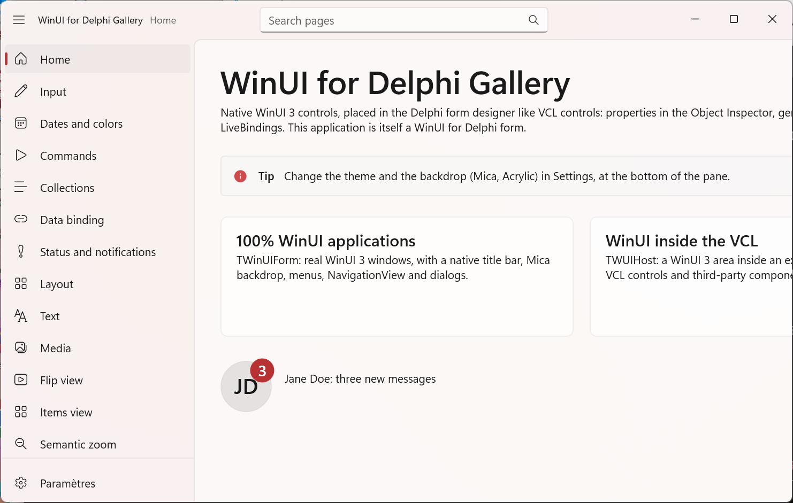
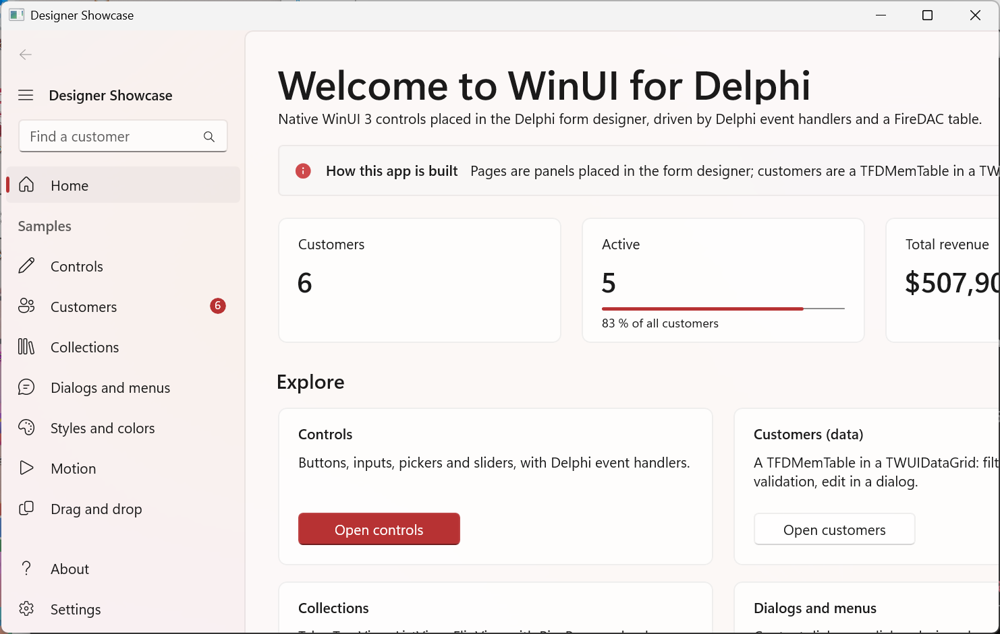
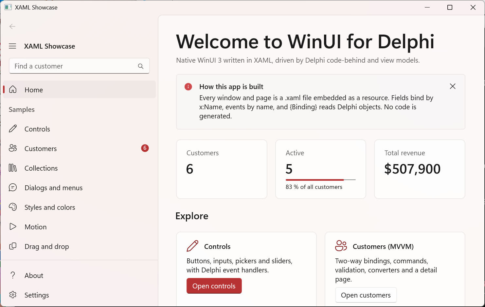
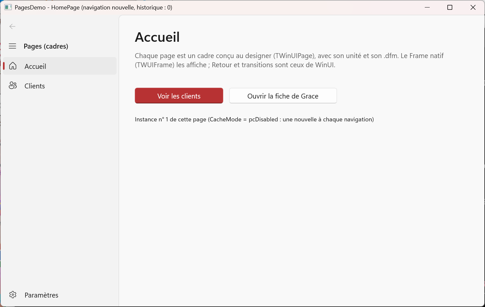

# WinUI for Delphi : démos exécutables

*[English](README.md) · Français*

Applications de démonstration de **WinUI for Delphi**, un kit qui permet d'écrire en Delphi des applications à l'interface **WinUI 3 native** (Windows App SDK 1.8). On l'utilise de deux façons :

- **au designer, comme en VCL** : on pose les contrôles WinUI 3 sur une fiche dans l'IDE Delphi (inspecteur d'objets, événements, LiveBindings) ;
- **en XAML** : fenêtres et pages écrites en XAML, pilotées par du code Delphi et des modèles de vue.

Ce dépôt ne contient que les exécutables (Windows 64 bits), pas de code source.

## Prérequis

- Windows 10 (version 1809 ou ultérieure) ou Windows 11, 64 bits.
- Le **runtime Windows App SDK 1.8** (x64), téléchargeable sur la page [Windows App SDK downloads](https://learn.microsoft.com/windows/apps/windows-app-sdk/downloads) de Microsoft.
- Pour la page WebView de la Gallery : le runtime **WebView2**, déjà présent sur Windows 11.

Il n'y a rien à installer d'autre : chaque exe est autonome. Les exécutables ne sont pas signés ; Windows SmartScreen peut demander une confirmation au premier lancement (*Informations complémentaires* > *Exécuter quand même*).

## Les démos

### Gallery : tous les contrôles, au designer

`Gallery\Gallery.exe` : le catalogue des contrôles WinUI 3 du kit, rangés par catégorie comme dans la WinUI 3 Gallery de Microsoft (saisie, dates, commandes, collections, liaison de données, notifications, mise en page, texte, médias…). L'application est elle-même une fiche conçue au designer Delphi. Les réglages (thème clair ou sombre, fond Mica ou Acrylic) sont en bas du volet. Garder le dossier `images` à côté de l'exe.

### Showcase (fiches) : une application complète au designer

`Showcase-Fiches\Showcase.exe` : une application de gestion de clients faite au designer. Volet de navigation, grille de données liée à une table FireDAC, validation, édition dans une boîte de dialogue, menus, styles, animations.

### Showcase (XAML) : la même application, en XAML

`Showcase-XAML\Showcase.exe` : la même application, cette fois écrite en XAML. Chaque fenêtre et chaque page est un fichier `.xaml` embarqué ; les champs se relient par `x:Name`, les événements par leur nom, et `{Binding}` lit les objets Delphi.

### PagesDemo : des pages conçues comme des cadres, navigation native

`PagesDemo\PagesDemo.exe` : chaque page a sa propre unité et son propre écran conçu au designer, et s'affiche par la navigation native de WinUI (historique, bouton Retour, transitions). La démo montre le paramètre de navigation, une page gardée en cache (le filtre de la liste reste au retour) et une page qui refuse d'être quittée tant qu'une saisie n'est pas enregistrée.

