# WinUI for Delphi

**Native WinUI 3 applications, written in Delphi.**

*English · [Français](README.fr.md)*

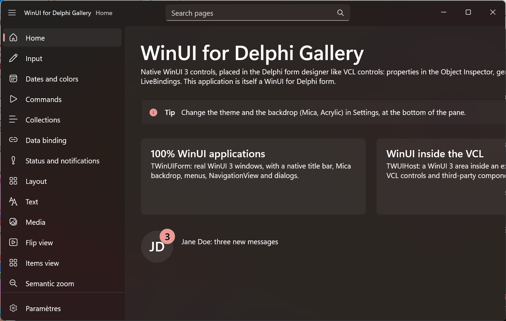

WinUI for Delphi brings **WinUI 3**, the modern Windows user interface of the Windows App SDK, to Delphi developers. It provides real WinUI 3 windows and controls instead of an imitation of them. You keep the Delphi way of working: the IDE, event handlers, data access and LiveBindings.

This repository contains **ready-to-run demo applications** (Windows, 64-bit). Download them, launch them and try the controls for yourself.

## Two ways to build

**In the form designer, like the VCL.** Drop WinUI 3 controls on a form in the Delphi IDE, set their properties in the Object Inspector and double-click to write event handlers. At run time the form is a real WinUI 3 window, with a native title bar, Mica backdrop, light and dark themes.

**In XAML.** Write windows and pages in XAML and drive them from Delphi code-behind and view models. `x:Name` connects fields, events are wired by name and `{Binding}` reads your Delphi objects. No code is generated.

## In the Delphi IDE

**The form designer.** WinUI 3 controls have their own pages in the Tool Palette. You drop them on a form, edit their properties in the Object Inspector and see the form take shape in the Structure view, exactly as with the VCL.

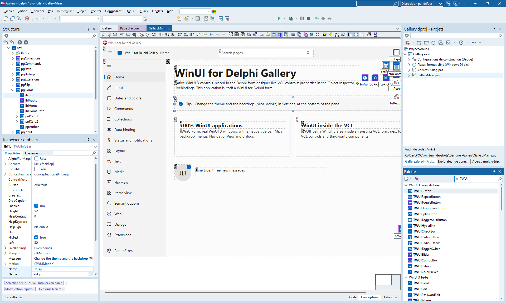

| | |
|---|---|
| 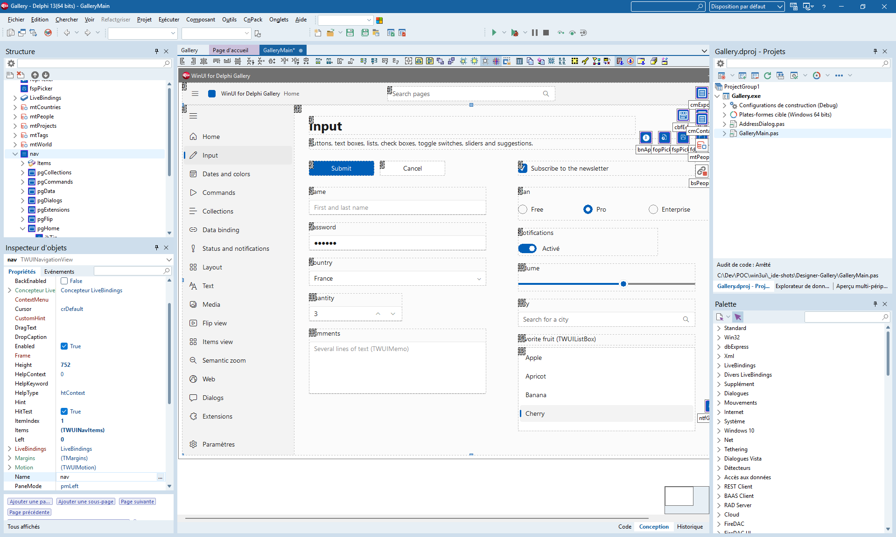 | 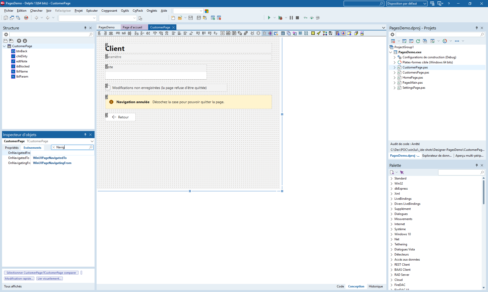 |
| **Navigation at design time**: click an item of the navigation pane and its page opens in the designer, ready to be edited. | **Pages as frames**: each page is a unit with its own design, created by the *WinUI 3 Page* wizard, with its navigation events in the Object Inspector. |

**The XAML designer.** XAML pages open in the IDE with a live, native preview next to the code. Click an element in the preview and the editor jumps to its line, while the XAML Structure and XAML Properties views follow the selection. A XAML palette inserts controls, and code completion knows the WinUI types.

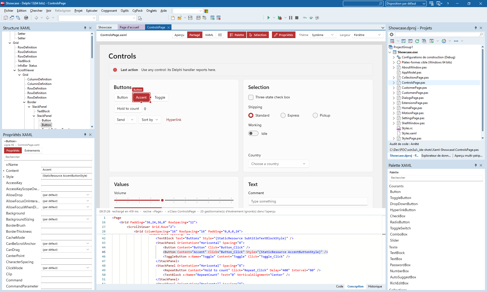

## Highlights

- **Native WinUI 3 controls**: buttons, text boxes, combo boxes, date and time pickers, calendar, color picker, rating, lists, tree view, grid view, data grid, command bar, menus, flyouts, dialogs, info bars, teaching tips, navigation view, tabs, breadcrumb bar, flip view, media player, web view and more.
- **Data binding**: LiveBindings link FireDAC datasets to WinUI controls with no code, and TActions drive the commands.
- **Pages and navigation**: design each page in its own unit and show it through native WinUI navigation, with history, the Back button and transitions.
- **Themes and backdrops**: light and dark themes, Mica and Acrylic, accent color, compact density.
- **Extensible**: write your own components (a multi-select combo box, a multi-column lookup, a date range picker…) without touching the kit.
- **WinUI inside the VCL**: an existing VCL application can host a WinUI 3 area next to its VCL controls.

## The demos

### Gallery: every control, built in the form designer

`Gallery\Gallery.exe` is a catalog of the controls, organized like Microsoft's WinUI 3 Gallery. The application is itself a Delphi form built in the designer. Theme and backdrop are in Settings, at the bottom of the pane.

| | |
|---|---|
| 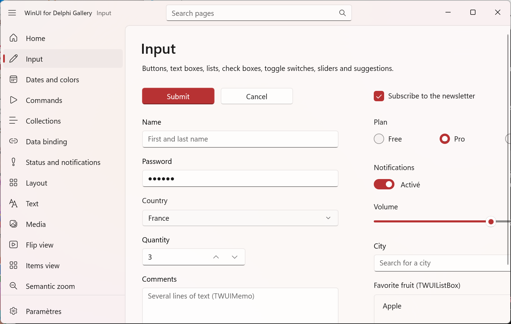 | 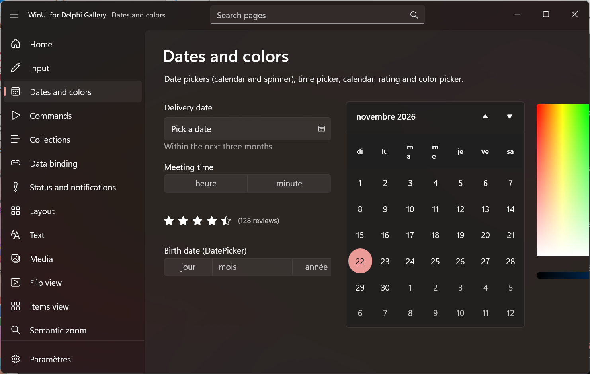 |
| **Input**: buttons, text boxes, combo box, number box, check boxes, radio buttons, toggle switch, slider, suggestions. | **Dates and colors**: date and time pickers, calendar view, rating and color picker, here in the dark theme. |
| 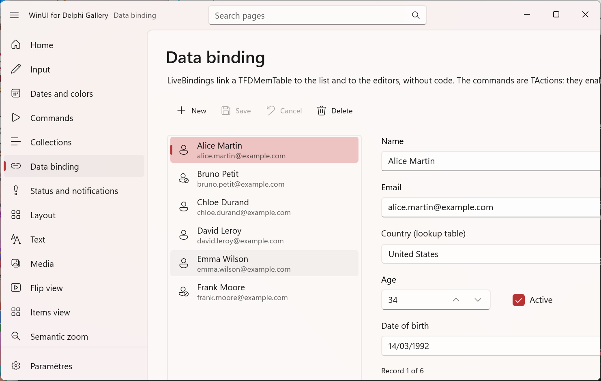 | 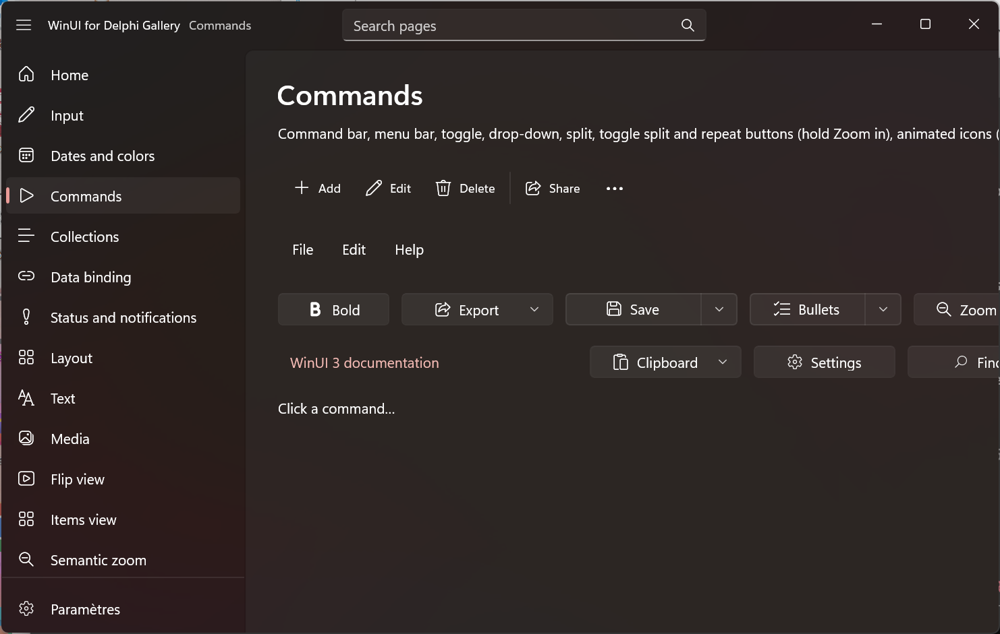 |
| **Data binding**: a FireDAC table bound to a list and editors with LiveBindings, no code. | **Commands**: command bar, menu bar, drop-down, split and toggle buttons, animated icons. |
| 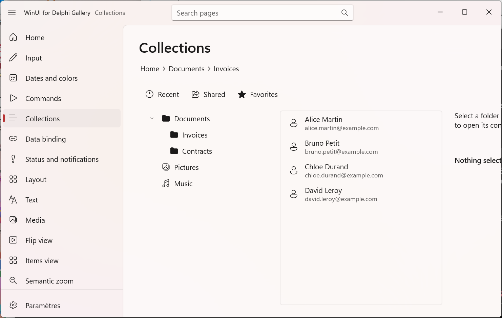 | 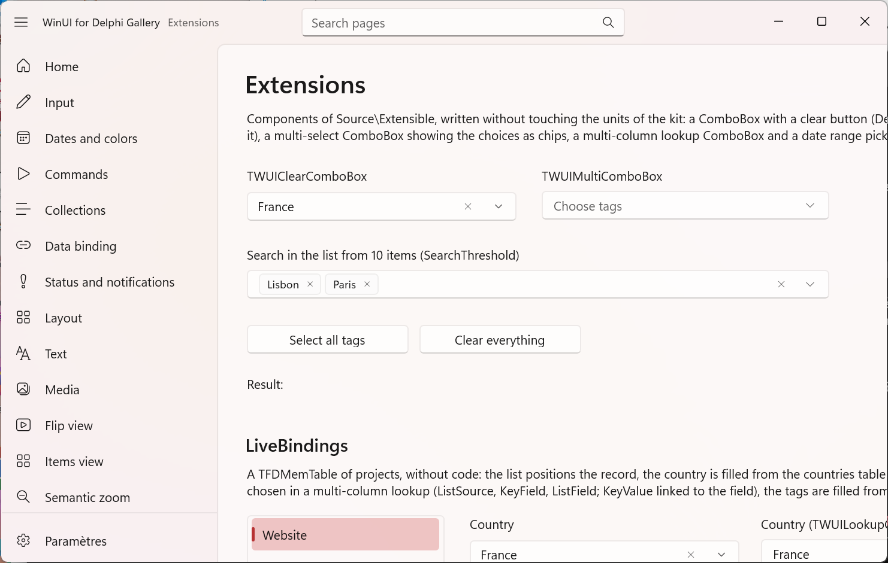 |
| **Collections**: breadcrumb bar, selector bar, tree view and list view. | **Extensions**: components added to the kit from the outside, such as a combo box with a clear button and a multi-select combo box. |

### Designer Showcase: a complete application, built in the designer

`Showcase-Fiches\Showcase.exe` is a customer management application: navigation pane, a data grid bound to a FireDAC table, validation, editing in a dialog, menus, styles and motion.

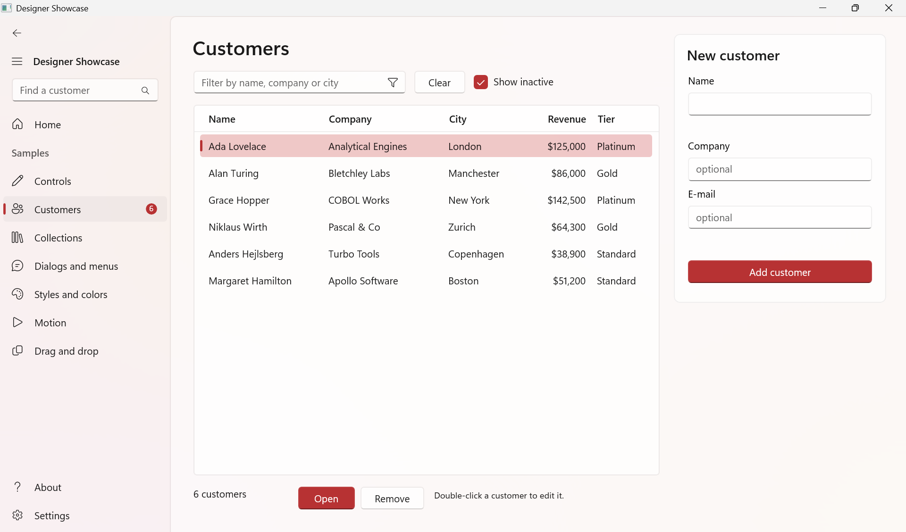

### XAML Showcase: the same application, in XAML

`Showcase-XAML\Showcase.exe`: every window and page is an embedded `.xaml` file, driven by Delphi code-behind and view models.

| | |
|---|---|
| 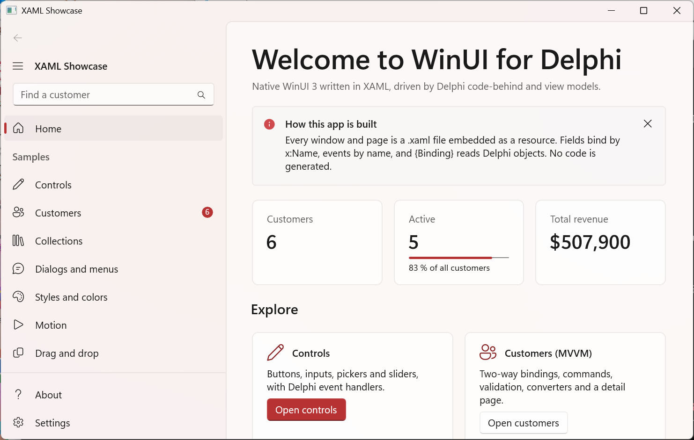 | 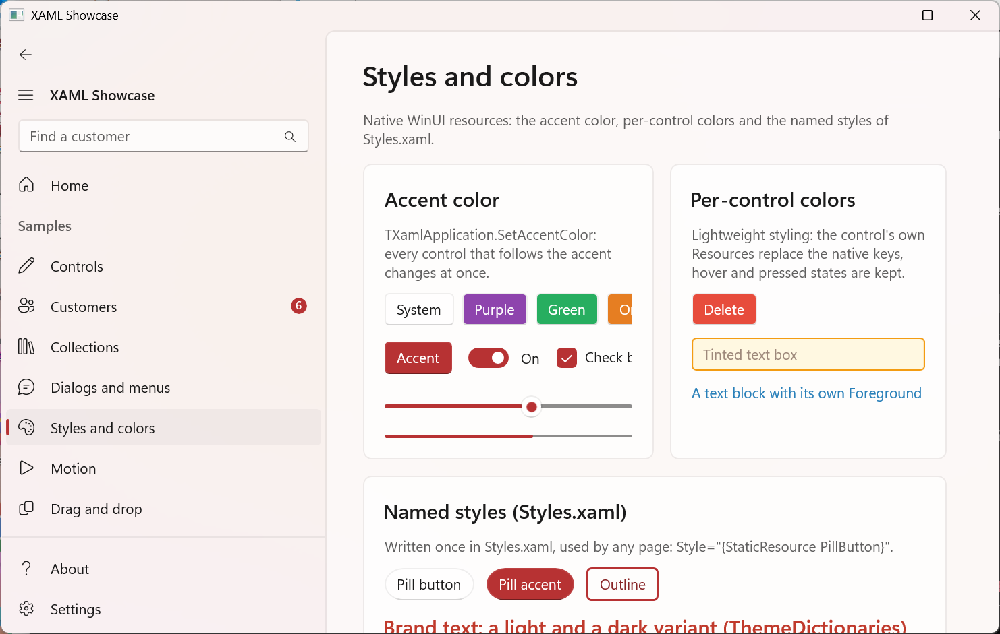 |
| **Home**: navigation view, info bar, summary cards. | **Styles and colors**: accent color, per-control colors and named styles from a shared `Styles.xaml`. |

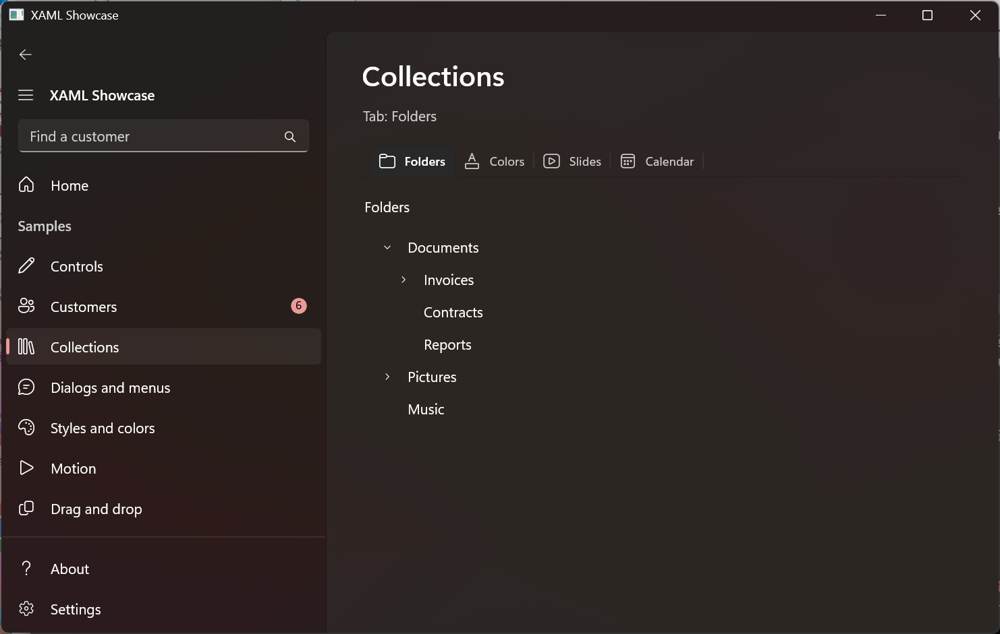

### PagesDemo: pages designed like frames, with native navigation

`PagesDemo\PagesDemo.exe`: each page has its own unit and its own design, and appears through native WinUI navigation. The demo shows a navigation parameter, a page kept in the cache (the list filter is still there when you come back) and a page that refuses to be left while an edit is unsaved. Its interface is in French.

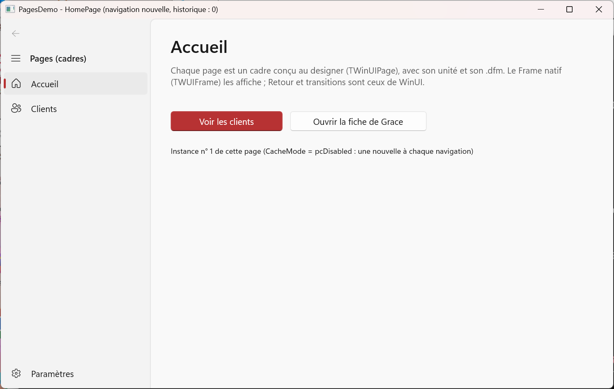

## Requirements

- Windows 10 (version 1809 or later) or Windows 11, 64-bit.
- The **Windows App SDK 1.8 runtime** (x64), from Microsoft's [Windows App SDK downloads](https://learn.microsoft.com/windows/apps/windows-app-sdk/downloads) page.
- For the web view page of the Gallery: the **WebView2** runtime, already installed on Windows 11.

Nothing else needs to be installed: each executable is self-contained. Keep the `images` folder next to `Gallery.exe`.

The executables are not signed, so Windows SmartScreen may ask for confirmation the first time (*More info* > *Run anyway*).

Native WinUI texts (date and time pickers, toggle switches, the Settings item…) follow the language of Windows: the screenshots were taken on a French Windows, with a French Delphi IDE.
